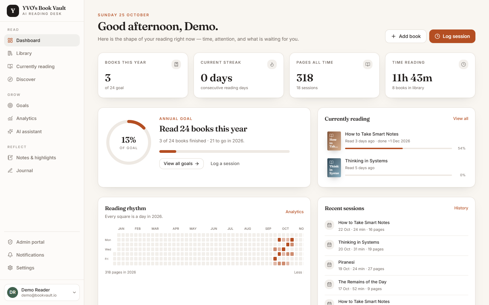
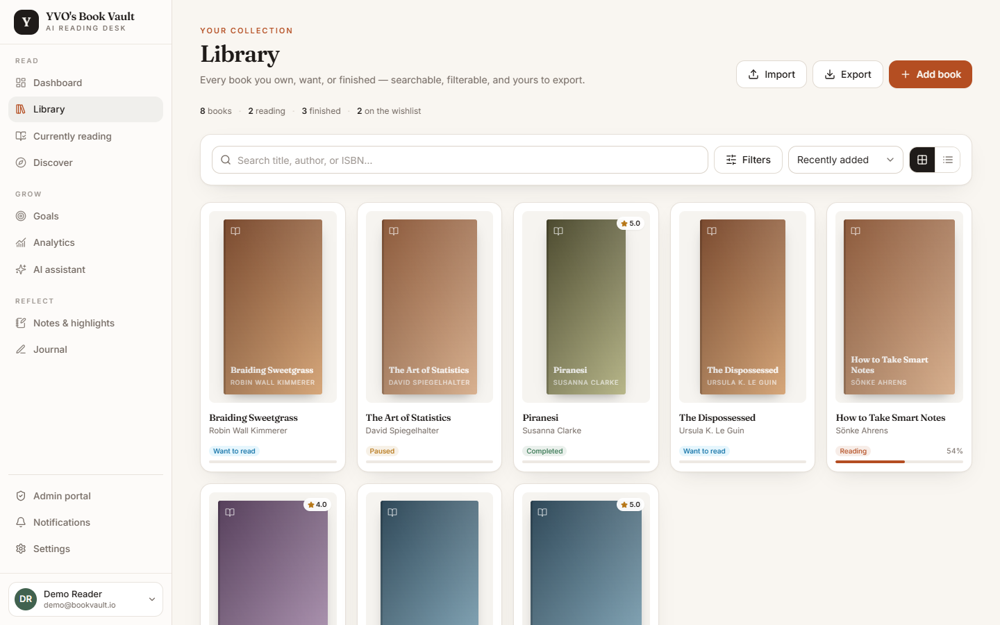
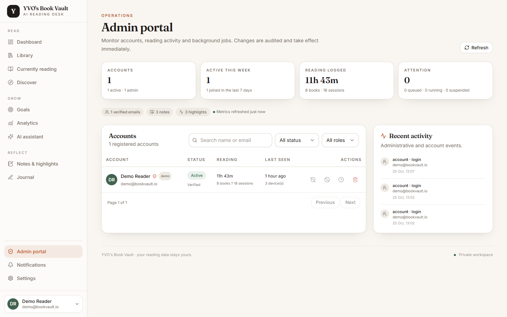
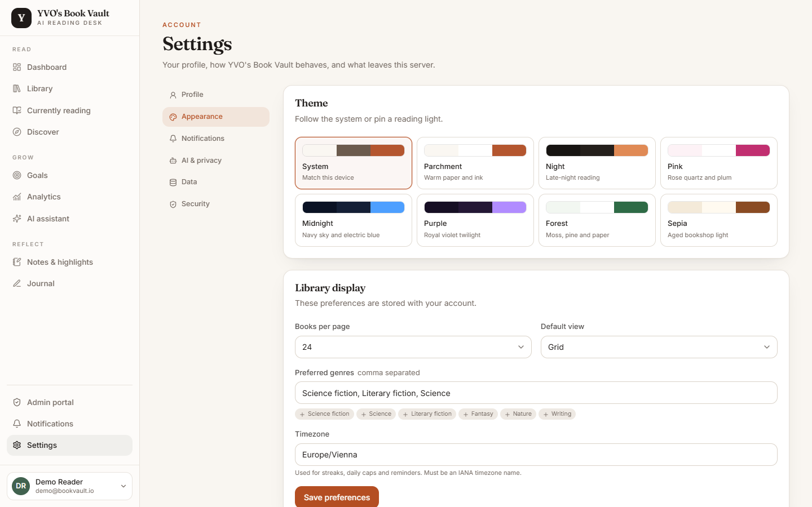
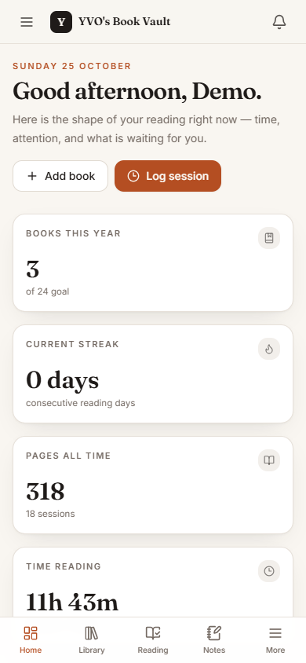
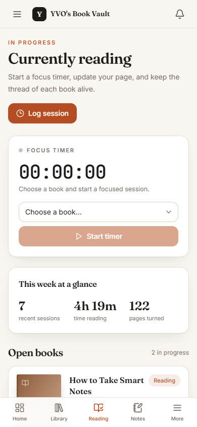
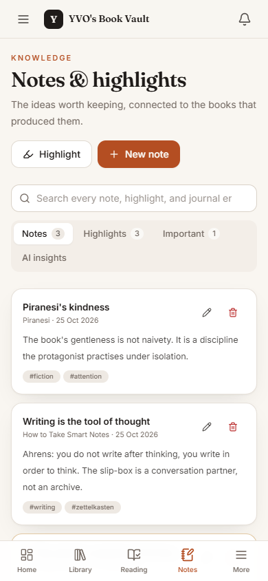
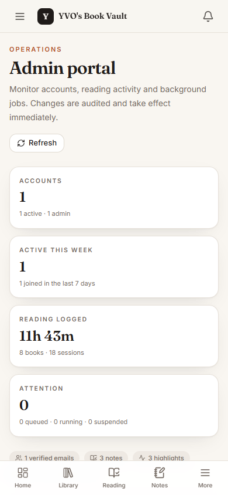

# YVO's Book Vault

A cloud-ready reading platform: library and catalogue management, a reading
timer and session history, analytics and goals, notes/highlights/journal, an
optional AI assistant that is grounded in your own books and notes, a
role-guarded administrator portal, eight visual themes, and a mobile-first app
shell.

The app is a working full-stack build: **57 backend tests and 15 frontend tests
pass**, the Python end-to-end smoke script passes, and the production frontend
build succeeds. It is configured for a single Vercel project; see
[Deployment status](#deployment-status) and [docs/DEPLOYMENT.md](docs/DEPLOYMENT.md).

## Screenshots

<p align="center">
  
</p>

| Library | Admin portal |
| --- | --- |
|  |  |

<p align="center">
  
</p>

| Mobile dashboard | Currently reading | Notes | Mobile admin |
| --- | --- | --- | --- |
|  |  |  |  |

- **Frontend:** React 18, TypeScript, Vite, Tailwind CSS, React Query, Recharts
- **Backend:** FastAPI, Pydantic v2, SQLAlchemy 2, Alembic, Python 3.12
- **Data:** PostgreSQL in production (Vercel Postgres/Neon), SQLite for local development and tests
- **Jobs:** inline execution on Vercel plus a daily cron; persistent database-backed worker on long-running hosts
- **Storage:** local filesystem in development, Vercel Blob on Vercel, S3/Cloudflare R2 on other hosts
- **Optional services:** OpenAI-compatible or Ollama AI, Resend email

## Feature set

### Reading
- Manual library CRUD with shelves, ratings, reviews, tags, progress and covers
- CSV/JSON import with a preview, duplicate detection and a background commit
- Catalogue search (Open Library, optional Google Books key) and ISBN lookup
- Reading timer with pause/resume, plus manual session logging and editing
- Dashboard, 30-day/12-month analytics, heatmap, streaks and pace projections
- Reading goals by books, pages, minutes, sessions, streak or genre, with
  recommended goals derived from actual history

### Knowledge
- Notes and highlights attached to books, with tags and full-text search
- Private dated journal with reflections, ideas, questions, lessons and
  applications
- AI insights extracted in the background and explicitly accepted or dismissed
  by the user before becoming notes

### AI (optional and off by default)
- Book summaries in eight formats, chat grounded in the user's library, source
  documents with citations, and catalogue-verified recommendations
- Every AI feature is gated on both server configuration **and** the user's
  `ai_enabled` / `ai_external_consent` settings
- The UI states what the assistant does not have rather than inventing sources

### Account and operations
- Email/password auth with scrypt hashing, opaque server-side sessions in an
  HttpOnly cookie, per-session CSRF tokens and session revocation
- Dedicated email-verification and password-reset pages, with expired/used
  token handling that explains what to do next
- Onboarding, profile, timezone, display preferences and data export
- Eight themes: System, Parchment, Night, Pink, Midnight, Purple, Forest, Sepia
- In-app notifications, weekly/monthly report previews, optional Resend email
- Background exports as CSV, JSON, Markdown, PDF or ZIP
- Mobile bottom navigation, slide-over menu, safe-area spacing and stacked
  cards/tables that work down to 320 px
- Administrator portal at `/admin`: account search and filters, activity feed,
  suspend/reactivate, promote/demote, revoke sessions and delete accounts, with
  self-lockout and last-admin guards
- Responsive "literary" interface with accessible focus states

## Quick start (local)

Requirements: Python 3.12, Node 20+, npm 10+. PostgreSQL is optional locally;
SQLite is the default.

```powershell
# 1. Configuration
Copy-Item .env.example .env
# Edit .env if you want different ports or integrations. The defaults use
# SQLite at backend/bookvault.db and http://localhost:5173.

# 2. Backend
cd backend
..\.venv\Scripts\python.exe -m pip install -r requirements-dev.txt
..\.venv\Scripts\python.exe -m alembic upgrade head
..\.venv\Scripts\python.exe scripts\seed.py --create
..\.venv\Scripts\python.exe -m uvicorn app.main:app --reload --port 8000
```

If the virtualenv does not exist yet:

```powershell
py -3.12 -m venv .venv
```

In a second terminal, start the background worker (imports, exports, AI,
email):

```powershell
cd backend
..\.venv\Scripts\python.exe -m app.tasks.worker
```

In a third terminal, start the frontend:

```powershell
cd frontend
npm ci
npm run dev
```

Open <http://localhost:5173>. The seed script prints the demo credentials:

- Email: `demo@bookvault.io`
- Password: `bookvault-demo-2026`

Change or delete this account before exposing the app. The local demo account is
also an administrator, so `/admin` is available immediately after sign-in.
Re-run the seed with `--reset` to rebuild its data.

Accounts listed in `ADMIN_EMAILS` are promoted automatically when they register
or sign in. The default development value is
`enendugodwin@gmail.com`; change it before exposing a deployment. Only list
email addresses you control, because registration does not yet require email
verification. Other accounts can be promoted from `backend/`:

```powershell
..\.venv\Scripts\python.exe scripts\admin.py promote owner@example.com
```

### macOS / Linux

The same steps with `python3 -m venv .venv`, `source .venv/bin/activate`, and
`python` instead of `..\.venv\Scripts\python.exe`.

## Tests and checks

```powershell
# Backend (from backend/)
$env:PYTHONPATH="."
..\.venv\Scripts\python.exe -m pytest -q

# End-to-end API smoke test (from backend/)
..\.venv\Scripts\python.exe scripts\smoke.py

# Frontend (from frontend/)
npm test
npm run typecheck
npm run build
```

Expected: `57 passed`, `ALL SMOKE CHECKS PASSED`, `15 passed`, and a Vite build
in `frontend/dist`.

## Configuration

Copy `.env.example` to `.env`. The full reference is in
[docs/ENVIRONMENT.md](docs/ENVIRONMENT.md). The most important variables:

| Variable | Purpose |
| --- | --- |
| `SECRET_KEY` | Signs short-lived tokens; use 32+ random characters |
| `DATABASE_URL` | `sqlite:///...` locally; on Vercel use the connected `POSTGRES_URL` |
| `FRONTEND_URL` / `ALLOWED_ORIGINS` | CORS and email link origins |
| `COOKIE_SECURE` / `COOKIE_SAMESITE` | Must be secure in production |
| `STORAGE_BACKEND` | `local`, `s3`, or `vercel_blob` |
| `CRON_SECRET` | Authenticates the Vercel Cron job tick endpoint |
| `EMAIL_PROVIDER` / `RESEND_API_KEY` | Optional outbound email |
| `AI_PROVIDER` / `AI_BASE_URL` / `AI_MODEL` | Optional AI; disabled by default |
| `FRONTEND_DIST_DIR` | Serve a built frontend from the API (single container/Vercel) |

Production startup intentionally fails fast when required security settings
are unsafe (placeholder secret, SQLite, insecure cookie, exposed reset tokens,
incomplete S3/AI/email configuration).

## Deployment

The primary topology is **one Vercel project**: FastAPI runs as a Python
function, the Vite bundle is served from the same app, Vercel Postgres supplies
the database and a private Vercel Blob store holds files. See
[docs/DEPLOYMENT.md](docs/DEPLOYMENT.md) for exact steps.

Included:

- `main.py` - Vercel FastAPI entrypoint; serves `/api/v1/*`, `/assets/*` and the
  SPA fallback from one origin
- `vercel.json` - frontend build, Python function settings, CSP/caching and the
  daily job-tick cron
- `requirements.txt` + `backend/requirements.txt` - Python dependencies
- `Dockerfile`, `docker-compose.yml`, `docker.env.example`, `render.yaml` -
  alternative long-running container topology
- `.github/workflows/ci.yml` - backend tests plus frontend typecheck/tests/build

### Deployment status

| Item | Status |
| --- | --- |
| Production build | Passes locally (`npm run build`) |
| Vercel all-in-one config | Authored (`main.py`, `vercel.json`); **not deployed here** |
| Vercel Postgres | **Connect the store in your Vercel project** |
| Vercel Blob | **Create a private store in your Vercel project** |
| Container image | Authored, **not built** (Docker unavailable on this host) |
| Resend / AI provider | **Not configured** (features stay disabled) |
| Public URL / credentials | Use your own Vercel project; do not invent or share any |

The app auto-applies Alembic migrations on the first cold start using a
PostgreSQL advisory lock. The cron endpoint requires `CRON_SECRET`; without it it
returns 503 rather than running unauthenticated.

## Architecture and security

See [docs/ARCHITECTURE.md](docs/ARCHITECTURE.md) for the data model, request
flow, job processing, AI grounding rules and deployment topology.

Highlights:

- Password hashes use scrypt; session and reset tokens are stored only as
  SHA-256 hashes
- Mutations require a per-session CSRF header; bearer tokens are supported for
  API clients and exempt from cookie CSRF
- Rate limits on auth and AI endpoints; uniform login errors; session
  revocation on password change
- Every user-owned query is scoped by `user_id`; object storage keys are
  generated server-side
- Admin endpoints require `is_admin` on every request and are audited; admins
  cannot suspend, demote or delete themselves, and the last active admin is
  protected
- Imports are previewed before writes; CSV exports guard against spreadsheet
  formula injection
- AI is disabled unless an operator configures it and the user consents

## Project layout

```
backend/
  app/api/          FastAPI routers (auth, books, sessions, goals, ...)
  app/core/         configuration, database, security, logging, rate limits
  app/models/       SQLAlchemy models
  app/schemas/      Pydantic request/response models
  app/services/     business logic (books, analytics, importer, exporter, AI)
  app/tasks/        worker loop and job handlers
  migrations/       Alembic environment and initial migration
  scripts/          smoke test and demo seed
  tests/            pytest suite
frontend/
  src/components/   layout, UI primitives and feature components
  src/pages/        routed pages
  src/lib/          API client, types, formatting helpers
  src/context/      auth and theme providers
  src/test/         Vitest setup and tests
docs/               architecture, environment and deployment
```

## Known limitations

- On Vercel, user-triggered background jobs run inline and schedules use a daily
  cron. On a long-running host, run the worker process; without it, queued jobs
  stay queued and the UI says so.
- Email and AI remain disabled until provider credentials are supplied. The UI
  explains the exact variables instead of simulating success.
- Catalogue search depends on Open Library/Google Books availability; imported
  manual metadata still works offline.
- Local file storage is not durable on ephemeral serverless filesystems. Use
  Vercel Blob on Vercel or S3/R2 on other hosts.
- AI output can be wrong. It is presented as assistance, with citations and a
  visible reminder to verify against the source.
