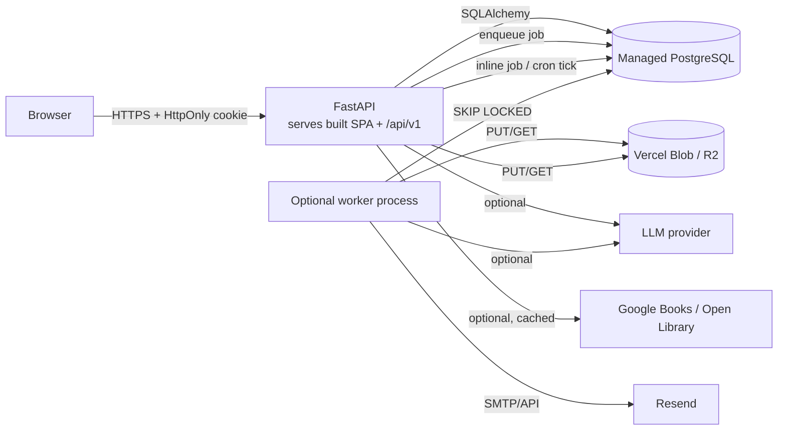

# YVO's Book Vault — Technical Architecture

Status: implemented baseline (local verification complete; cloud deployment requires your Vercel account).

## 1. Components

| Component | Technology | Responsibility |
|---|---|---|
| Web client | React 18 + TypeScript + Vite + Tailwind, shadcn-style local component primitives | All 11 product areas, responsive UI, theme, accessibility, timer, charts |
| API | Python 3.12 + FastAPI + Pydantic v2 + SQLAlchemy 2 | Versioned REST API, auth, authorization, validation, aggregation, job dispatch |
| Database | PostgreSQL 16 (managed in production); SQLite for local tests only | Durable relational state, transactions, constraints, indexes |
| Worker | Inline execution in Vercel requests plus a daily Vercel Cron; `python -m app.tasks.worker` on long-running hosts, using the DB-backed `background_jobs` queue (`FOR UPDATE SKIP LOCKED`) | AI generation, exports, imports, email/report delivery, scheduled notifications |
| Object storage | Private Vercel Blob on Vercel; S3-compatible (Cloudflare R2) or local directory on other hosts | Uploaded source documents, generated export files |
| AI provider | OpenAI-compatible HTTP API or Ollama-compatible endpoint; disabled by default | Summaries, chat, recommendations, knowledge extraction |
| Catalogue | Google Books + Open Library, cached in `catalogue_cache` | Metadata discovery; degrades gracefully |
| Email | Resend API (optional) | Reminders and reports; delivery status recorded from provider response |

The API is stateless apart from the database and object storage, so it can scale horizontally. The SPA is a static bundle served by the same FastAPI app, which keeps cookies first-party.

## 2. Authentication and authorization

- Registration creates a `users` row plus `user_settings`; password hashed with scrypt (per-user salt, 64-byte output, constant-time compare).
- Login creates an opaque 256-bit session token. Only its SHA-256 hash is stored. The raw token lives in an **HttpOnly** cookie (`bv_session`), `Secure` in production. `SameSite=Lax` for the same-origin Vercel or single-container deployment; `SameSite=None` only when the SPA is on a different site.
- Every session row carries a CSRF token. Authenticated state-changing requests must send `X-CSRF-Token`; the server compares it to the session row.
- Session expiry (30 days default) and explicit revocation on logout. Password change and account deletion revoke all sessions.
- Every private query filters by `user_id`. Objects are never fetched by id alone for user access. Cross-user access returns 404 (not 403) to avoid existence leaks. This is covered by automated authorization tests.
- Reset tokens are random, stored hashed, single-use, and expire in 60 minutes. In development the reset URL is returned only when `EXPOSE_RESET_TOKEN=true` (never in production). Verification tokens expire in 48 hours. Both link to dedicated SPA pages (`/reset-password`, `/verify-email`) that handle missing, expired and already-used tokens.
- Rate limits: in-process sliding-window limiter on auth endpoints (per IP) and per-user daily AI quotas persisted in `ai_usage_records`.

Threat assumptions: HTTPS terminates at the platform; cookies are `Secure` in production. XSS is mitigated with React escaping, a strict CSP, and no `dangerouslySetInnerHTML` on user or AI content (Markdown rendered as preformatted text). SQL injection is prevented by SQLAlchemy parameter binding. Uploaded files are validated by size/type/extension and never executed or served inline.

## 3. Core calculations (single source of truth)

Implemented in `app/services/metrics.py`:

- `pages_read = max(0, end_page - start_page)` for a session; unknown page counts are allowed and excluded from page aggregates.
- `progress_percent = current_page / page_count * 100` clamped to 0–100; `None` when `page_count` is unknown/zero (never divide by zero).
- `pages_per_hour = pages_read / (duration_seconds / 3600)`; `None` for zero duration.
- Session duration is wall-clock between `started_at` and `ended_at` minus explicitly paused seconds (`paused_seconds`).
- Sessions crossing midnight are stored in UTC and counted on the **local date of `started_at`** using the user's timezone for heatmaps/reports. A session is aggregated exactly once.
- Streak: count consecutive local days with at least one completed session ending today or yesterday. A gap of one day breaks the streak.
- Goal progress is computed from the goal's own `[start_date, end_date]` window, never from a calendar-year assumption. Required pace = remaining target ÷ remaining whole days (minimum 1).
- Analytics only read persisted sessions/books. Deleting a session immediately removes it from all aggregates.
- Book completion is explicit (`status=completed` sets `completed_at`); it is never inferred.

## 4. AI design

`AIProvider` protocol with implementations:

1. `OpenAICompatibleProvider` — `POST {base_url}/chat/completions` with bearer key.
2. `OllamaProvider` — `POST {base_url}/api/chat`.
3. `DisabledProvider` — raises a typed `AIUnavailable`, enabling graceful degradation.

Prompts are built only from: catalogue metadata, the user's own notes/highlights, and text they uploaded. Each request records provider/model/tokens/status in `ai_usage_records`. Returned text is labelled with coverage (`metadata_only`, `notes_only`, `document_extract`, `mixed`) and a caveat. The system prompt forbids inventing quotations, page numbers, or chapter content. AI output is never auto-persisted into notes — knowledge extraction returns reviewable candidate insights.

Long-running AI work runs via `background_jobs`; the API returns `202` with a job id, and the client polls `/jobs/{id}`.

## 5. Data flow examples

**Add a book from discovery:** SPA → `GET /catalogue/search` (cached, 10s timeout) → user selects → `POST /books` with metadata → canonical `books` row (deduplicated by ISBN then normalized title+author) → `user_books` row for the caller.

**Reading session:** timer posts start → optional pause/resume accumulates paused seconds → end sends `{started_at, ended_at, paused_seconds, start_page, end_page}` → server validates ranges and timestamps → inserts session and updates `current_page` in one transaction → aggregates recomputed on read.

**Export:** `POST /exports` creates `export_jobs` + `background_jobs` → on Vercel the request runs the handler inline; on a container host the worker builds CSV/JSON/Markdown/PDF → file stored in Blob/S3/local → status endpoint exposes an authenticated download. CSV cells beginning with `= + - @` are prefixed with `'` (formula-injection defense).

## 6. Deployment topology

Recommended: **one Vercel project**. `main.py` exports the FastAPI app; Vercel's
Python runtime routes `/api/v1/*`, `/assets/*` and client-side routes to it. The
Vite bundle is built into `frontend/dist` and served from the same origin.

- Database: Vercel Postgres (Neon); runtime uses pooled `POSTGRES_URL`, Alembic
  uses `POSTGRES_URL_NON_POOLING`.
- Migrations: applied on cold start under a PostgreSQL advisory lock, or run as
  a release step with `AUTO_MIGRATE=false`.
- Storage: private Vercel Blob. Uploads/exports are streamed through the API.
- Jobs: user-triggered jobs run inline; `/api/v1/internal/jobs/tick` is called by
  Vercel Cron daily and requires `CRON_SECRET`.
- Cookies: `SameSite=Lax` and `Secure` because the app is same-origin.

Alternative: one Docker image serves the built SPA and API. `bookvault-api` runs
`alembic upgrade head` then uvicorn; `bookvault-worker` runs
`python -m app.tasks.worker`; storage is private R2/S3 or a persistent local
volume. `render.yaml` and `docker-compose.yml` express this topology.

Configuration is environment-variable driven; see `.env.example`. Startup fails
fast in production if required secrets, PostgreSQL, cookie security, reset-token
exposure or selected integrations are misconfigured.

Deployment assets are authored but were not applied from this workspace. See
`docs/DEPLOYMENT.md` and `PROGRESS.md`.

## 7. Deliberate limits

- No Kubernetes or microservices: a single API image + worker + managed Postgres is sufficient for the expected load and cheaper to operate.
- The in-process rate limiter is per-instance; for multi-instance deployments move it to Redis (documented).
- The catalogue depends on third-party availability; the UI shows explicit degraded states.
- AI is optional and disabled unless configured; no output is fabricated when it is off.
